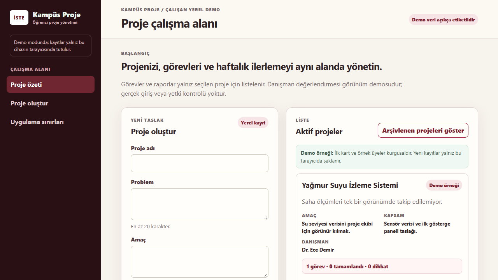

# Örnek hata raporu

> Bu dosya `npm run test:e2e:demo` çıktısından alınmış **örnek** bir rapordur (bilerek kırık senaryolar). İzleme (trace) dosyaları ve diğer ekran görüntüleri depoya eklenmedi; gerçek çalıştırmada `test-reports/` altında üretilir.

Oluşturulma: 2026-10-30T22:14:05.804Z · Başarısız test: 4

| # | Test | Tanı |
|---|---|---|
| 1 | bilerek-kirik.spec.ts › olmayan bir başlık görünür olmalı (öğe bulunamadı) | Beklenen öğe sayfada bulunamadı |
| 2 | bilerek-kirik.spec.ts › olmayan bir düğmeye tıklanır (tıklama beklerken zaman aşımı) | Beklenen öğe sayfada bulunamadı |
| 3 | bilerek-kirik.spec.ts › sayfa başlığı yanlış beklenir (beklenti uyuşmazlığı) | Beklenen değer ile gerçek değer farklı |
| 4 | bilerek-kirik.spec.ts › geniş seçici birden fazla öğeyle eşleşir (strict mode) | Seçici birden fazla öğeyle eşleşti |

## 1. bilerek-kirik.spec.ts › olmayan bir başlık görünür olmalı (öğe bulunamadı)

- **Konum:** `e2e-demo/bilerek-kirik.spec.ts:10`
- **Süre:** 2470 ms
- **Tanı:** Beklenen öğe sayfada bulunamadı (`oge-bulunamadi`)
- **Seçici:** `getByRole('heading', { name: 'Bu başlık sayfada yok' })`
- **Önerilen ilk adım:** Metin, etiket veya rol değişmiş ya da öğe henüz çizilmemiş olabilir. Seçiciyi arayüzdeki güncel metinle karşılaştırın; önceki adım (örneğin bir kayıt) başarısız olduysa öğe hiç oluşmamıştır.
- **Yeniden çalıştır:** `npx playwright test -c playwright.demo.config.ts e2e-demo/bilerek-kirik.spec.ts:10`

### Hata

```text
Error: expect(locator).toBeVisible() failed

Locator: getByRole('heading', { name: 'Bu başlık sayfada yok' })
Expected: visible
Timeout: 2000ms
Error: element(s) not found

Call log:
  - Expect "toBeVisible" getByRole('heading', { name: 'Bu başlık sayfada yok' }) with timeout 2000ms
  - waiting for getByRole('heading', { name: 'Bu başlık sayfada yok' })
```

### Kod çerçevesi

```text
   9 |
  10 | test('olmayan bir başlık görünür olmalı (öğe bulunamadı)', async ({ page }) => {
> 11 |   await expect(page.getByRole('heading', { name: 'Bu başlık sayfada yok' })).toBeVisible()
     |                                                                              ^
  12 | })
  13 |
  14 | test('olmayan bir düğmeye tıklanır (tıklama beklerken zaman aşımı)', async ({ page }) => {
```

### Ekler



## 2. bilerek-kirik.spec.ts › olmayan bir düğmeye tıklanır (tıklama beklerken zaman aşımı)

- **Konum:** `e2e-demo/bilerek-kirik.spec.ts:14`
- **Süre:** 2495 ms
- **Tanı:** Beklenen öğe sayfada bulunamadı (`oge-bulunamadi`)
- **Seçici:** `getByRole('button', { name: 'Olmayan düğme' })`
- **Önerilen ilk adım:** Metin, etiket veya rol değişmiş ya da öğe henüz çizilmemiş olabilir. Seçiciyi arayüzdeki güncel metinle karşılaştırın; önceki adım (örneğin bir kayıt) başarısız olduysa öğe hiç oluşmamıştır.
- **Yeniden çalıştır:** `npx playwright test -c playwright.demo.config.ts e2e-demo/bilerek-kirik.spec.ts:14`

### Hata

```text
TimeoutError: locator.click: Timeout 2000ms exceeded.
Call log:
  - waiting for getByRole('button', { name: 'Olmayan düğme' })
```

### Kod çerçevesi

```text
  13 |
  14 | test('olmayan bir düğmeye tıklanır (tıklama beklerken zaman aşımı)', async ({ page }) => {
> 15 |   await page.getByRole('button', { name: 'Olmayan düğme' }).click({ timeout: 2000 })
     |                                                             ^
  16 | })
  17 |
  18 | test('sayfa başlığı yanlış beklenir (beklenti uyuşmazlığı)', async ({ page }) => {
```

## 3. bilerek-kirik.spec.ts › sayfa başlığı yanlış beklenir (beklenti uyuşmazlığı)

- **Konum:** `e2e-demo/bilerek-kirik.spec.ts:18`
- **Süre:** 2439 ms
- **Tanı:** Beklenen değer ile gerçek değer farklı (`beklenti-uyusmadi`)
- **Önerilen ilk adım:** Uygulama çalıştı ama farklı bir sonuç üretti. "Expected" ve "Received" satırlarını karşılaştırın; hata uygulamada mı testte mi karar verin.
- **Yeniden çalıştır:** `npx playwright test -c playwright.demo.config.ts e2e-demo/bilerek-kirik.spec.ts:18`

### Hata

```text
Error: expect(page).toHaveTitle(expected) failed

Expected: "Gerçekte olmayan sayfa başlığı"
Received: "Kampüs Proje"
Timeout:  2000ms

Call log:
  - Expect "toHaveTitle" with timeout 2000ms
    20 × locator resolved to <html lang="tr">…</html>
       - unexpected value "Kampüs Proje"
```

### Kod çerçevesi

```text
  17 |
  18 | test('sayfa başlığı yanlış beklenir (beklenti uyuşmazlığı)', async ({ page }) => {
> 19 |   await expect(page).toHaveTitle('Gerçekte olmayan sayfa başlığı')
     |                      ^
  20 | })
  21 |
  22 | test('geniş seçici birden fazla öğeyle eşleşir (strict mode)', async ({ page }) => {
```

## 4. bilerek-kirik.spec.ts › geniş seçici birden fazla öğeyle eşleşir (strict mode)

- **Konum:** `e2e-demo/bilerek-kirik.spec.ts:22`
- **Süre:** 535 ms
- **Tanı:** Seçici birden fazla öğeyle eşleşti (`birden-fazla-eslesme`)
- **Seçici:** `getByRole('button')`
- **Önerilen ilk adım:** Seçiciyi daraltın (rol + ad, `exact: true` veya bir kapsayıcı içinde arama); sayfaya yeni bir benzer öğe eklenmiş olabilir.
- **Yeniden çalıştır:** `npx playwright test -c playwright.demo.config.ts e2e-demo/bilerek-kirik.spec.ts:22`

### Hata

```text
Error: locator.click: Error: strict mode violation: getByRole('button') resolved to 6 elements:
    1) <button type="submit">Proje taslağını kaydet</button> aka getByRole('button', { name: 'Proje taslağını kaydet' })
    2) <button type="button" class="secondary-button compact-button">Arşivlenen projeleri göster</button> aka getByRole('button', { name: 'Arşivlenen projeleri göster' })
    3) <button type="button" aria-pressed="false" class="secondary-button">Yağmur Suyu İzleme Sistemi çalışma alanını aç</button> aka getByRole('button', { name: 'Yağmur Suyu İzleme Sistemi ç' })
    4) <button type="button">Yedek indir</button> aka getByRole('button', { name: 'Yedek indir' })
    5) <input type="file" id="backup-json-file" accept="application/json,.json" aria-describedby="backup-restore-warning backup-file-status"/> aka getByRole('button', { name: 'Yedek JSON dosyası' })
    6) <button disabled type="button">Yedeği geri yükle</button> aka getByRole('button', { name: 'Yedeği geri yükle' })

Call log:
  - waiting for getByRole('button')
```

### Kod çerçevesi

```text
  21 |
  22 | test('geniş seçici birden fazla öğeyle eşleşir (strict mode)', async ({ page }) => {
> 23 |   await page.getByRole('button').click({ timeout: 2000 })
     |                                  ^
  24 | })
  25 |
```
